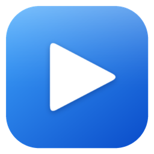
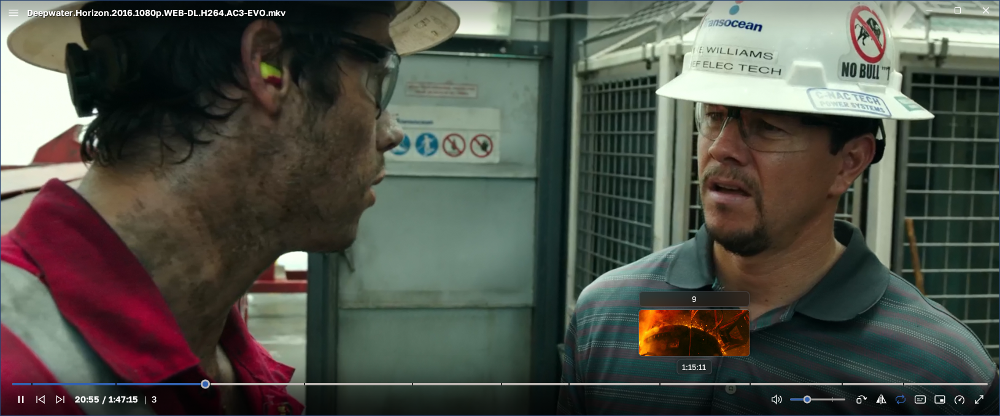
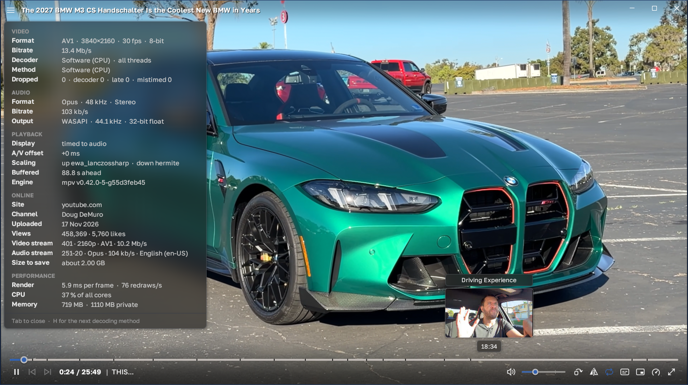
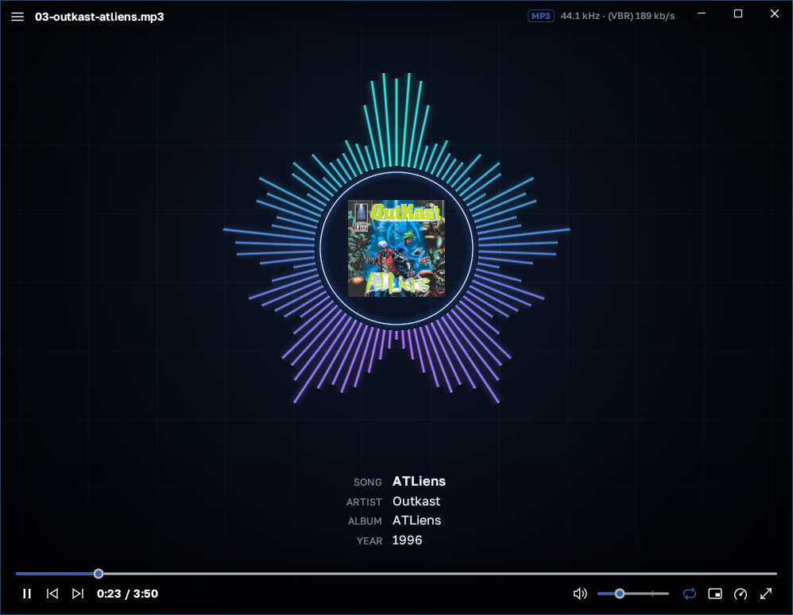
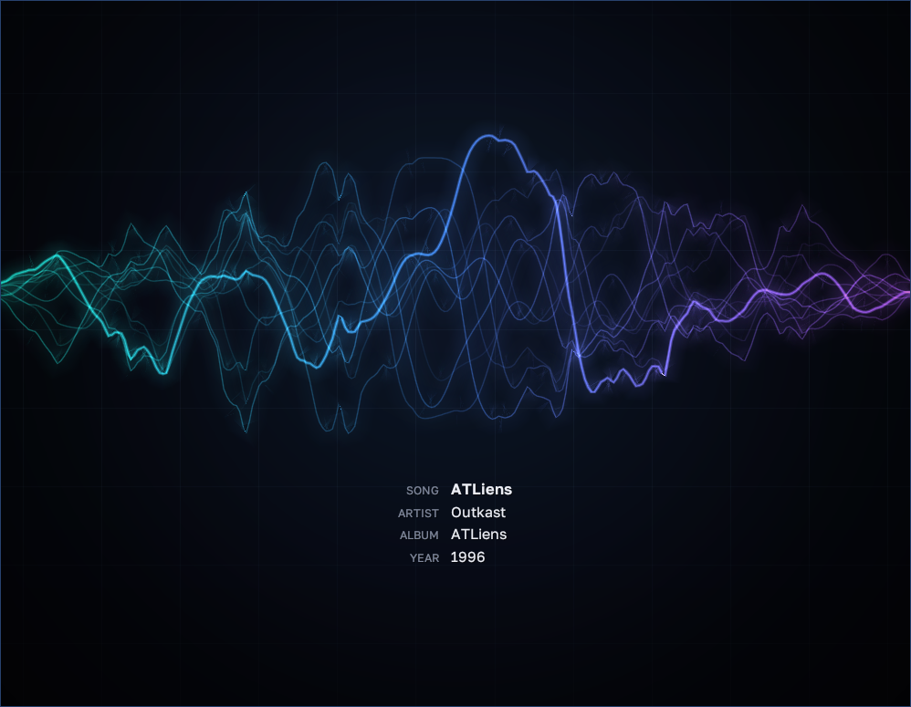
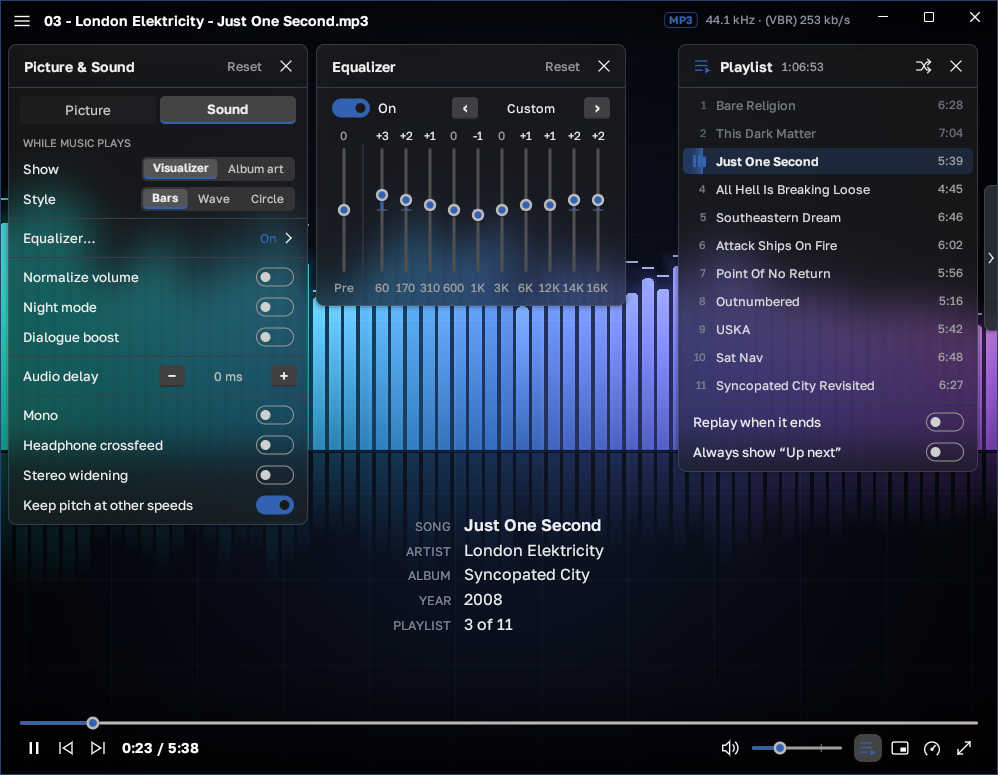
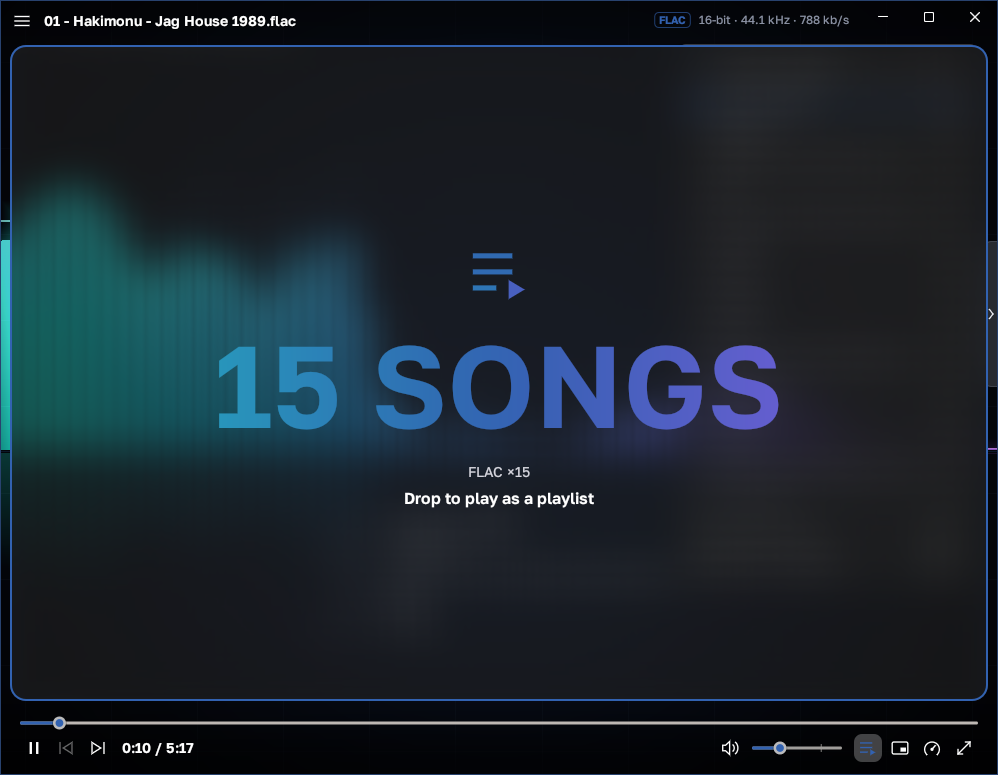

# Rust Media Player

**A fast, good-looking video and music player for Windows, built on mpv.**

Plays just about anything: local files, YouTube and other sites, music with a live visualizer.
No clutter, no history, no telemetry.

<!-- HERO: a video playing with the controls showing and the seek-bar thumbnail
     preview up (hover the seek bar). 1280×720-ish window, PNG. -->

---

## Highlights

- **Plays nearly everything.** Videos, music and pictures, through [mpv](https://mpv.io) and its
  hardware decoding: MP4, MKV, AVI, WebM, MP3, FLAC, AAC, Opus, JPG, PNG, GIF, M3U playlists
  and more.
- **Online video.** Paste a YouTube (or other site) link and it plays, using
  [yt-dlp](https://github.com/yt-dlp/yt-dlp). Pick the quality, codec and audio language, save the
  video, or save just a clip of it. Live streams show as **● Live**.
- **Music made to look at.** Three visualizer styles (Bars, Wave and Circle), an album-art
  screen, and the song's details: title, artist, album, year and the exact format
  (`FLAC · 16-bit · 44.1 kHz`, `MP3 · (VBR) 245 kb/s`).
- **Playlists that keep up.** Open or drop a handful of files and they become a playlist in the
  same order Explorer shows them. A slide-out panel shows each song's progress, with
  shuffle and replay.
- **Looks like it belongs on Windows 11.** A frameless window with your Windows accent colour,
  frosted-glass menus, snapping to screen edges, and controls on the taskbar thumbnail.

---

## Video

<!-- A video in full swing, or the seek bar hovered on a YouTube video so the
     "most replayed" hill shows. -->

- **Seek-bar thumbnails** for local files and online videos, with chapter titles above them
- **YouTube's "most replayed" graph** rises above the seek bar while you hover it
- **Picture & Sound** (`E`): brightness, contrast, colour temperature, sharpening, denoising,
  debanding, deinterlacing, smooth motion and high-quality upscaling
- Frame-by-frame stepping (`D` / `F`), rotating, mirroring, playback speed and subtitles
- **Save clip as**: mark a start and end on the seek bar and save just that part of any video,
  local or online

## Music

<!-- Two screenshots side by side work well here: the Circle visualizer with a
     cover inside it, and the Wave. -->

  
  

- **Bars, Wave or Circle** visualizers, drawn from the music itself (low CPU, no GPU-heavy effects)
- **Album art** screen with the cover, or a slowly drifting details card when a song has none
- The song's details from its tags, and its format and bitrate in the title bar
- A **10-band equalizer**, volume normalizing, night mode, dialogue boost, crossfeed and more

## Playlists

<!-- A short clip (MP4 or GIF) of opening several songs from Explorer, the
     playlist sliding out from its tab, and clicking a song. -->

- Select several files in Explorer and press **Open**, or drag them in: they play as a playlist,
  in Explorer's order
- `.m3u` playlists, shuffle, "replay when it ends", and a small **Up next** card
- The playing song's row fills as it plays

## Drag and drop

<!-- A GIF of dragging a song (or a few) over the window: the blur, the frame
     and "FLAC" / "8 SONGS" in big letters. -->

Drag something over the window and it tells you what it is (**FLAC**, **MP4**, **8 SONGS**)
before you let go, and greys out anything it can't play.

---

## Download

Grab the latest build from the [**Releases**](https://github.com/kbc8090/rust-mediaplayer/releases)
page (or the newest successful run under [Actions](https://github.com/kbc8090/rust-mediaplayer/actions)),
unzip it anywhere and run `RustMediaPlayer.exe`.

Everything it needs comes in the zip: libmpv, yt-dlp, Deno (which yt-dlp uses for YouTube)
and a small FFmpeg for saving clips. Nothing is installed.

**Requires** Windows 10 or 11, 64-bit.

## Keyboard shortcuts

| Key | Action | | Key | Action |
|---|---|---|---|---|
| `Space` | Play / pause | | `Ctrl+O` | Open file |
| `←` `→` | Back / forward 5 seconds | | `Ctrl+U` | Open URL |
| `↑` `↓` / wheel | Volume | | `Ctrl+V` | Play a copied link |
| `M` | Mute | | `Ctrl+S` | Save video (online videos) |
| `P` / `N` | Previous / next file | | `Ctrl+Shift+S` | Save clip |
| `D` / `F` | Previous / next frame | | `[` `]` | Clip start / end at the playhead |
| `Enter` / double-click | Full screen | | `Z` | Zoom the seek bar around the clip |
| `Esc` | Leave full screen / close menu | | `E` | Picture & Sound |
| `R` | Rotate 90° | | `L` | Playlist |
| Right-click | Main menu | | `Tab` | Video info |
| Media keys | Play / pause, next, previous | | `H` | Next decoding method |

## Privacy

- No recent-files list and no watch history: nothing about what you play is saved.
- No telemetry, accounts or ads.
- Settings are plain text files in `%APPDATA%\rust-mediaplayer`. Delete the folder and the
  player starts fresh.
- The only network access is what you ask for: opening an online link (through yt-dlp), and
  fetching a newer yt-dlp when a link fails because the site has changed.

## Building from source

The [build workflow](.github/workflows/build.yaml) is the reference: it fetches the newest
libmpv, builds the player with `cargo build --release`, and bundles yt-dlp, Deno and FFmpeg next
to it. To build locally you need Rust (MSVC toolchain) and `libmpv-2.dll` plus an import
library for it. The workflow shows how to make one.

## Built with

[mpv](https://mpv.io) · [yt-dlp](https://github.com/yt-dlp/yt-dlp) ·
[FFmpeg](https://ffmpeg.org) · [egui](https://github.com/emilk/egui) ·
[Symphonia](https://github.com/pdeljanov/Symphonia) · [Deno](https://deno.com) ·
[Golos Text](https://github.com/googlefonts/golos-text-font)

## License

<!-- TODO: pick a license (MIT is the common choice for apps like this). Without one,
     others can look at the code but have no right to use or share it. -->
